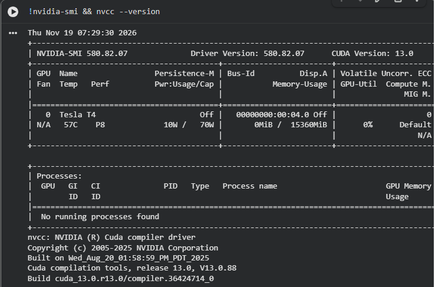
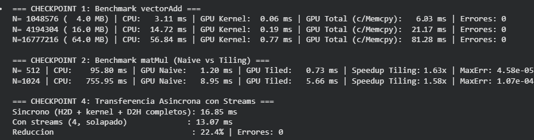
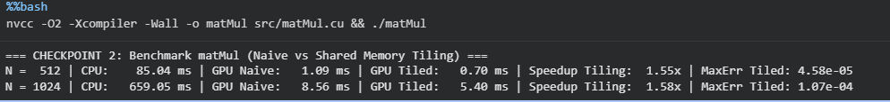
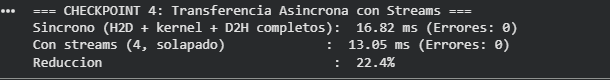

# Post-Contenido 1 — Benchmark CUDA (CPU vs. GPU) y Análisis Comparativo de Aceleradores de IA

**Asignatura:** Arquitectura de Computadores — Unidad 11  
**Estudiante:** Luis Jesús Pérez (`luisjesuspb`)  
**Repositorio:** `Perez-post1-u11`  
**Documento Parte 2:** [`docs/analisis-comparativo.md`](docs/analisis-comparativo.md)

---

## 1. Descripción del Entorno de Ejecución

Las pruebas empíricas de la Parte 1 se ejecutaron sobre una instancia acelerada por hardware NVIDIA en Google Colab:

| Componente | Especificación |
|:-----------|:---------------|
| **GPU Aceleradora** | NVIDIA Tesla T4 (Arquitectura Turing, 2,560 CUDA Cores, 320 Tensor Cores, 15,360 MiB GDDR6) |
| **Driver NVIDIA / CUDA** | Driver `580.82.07` · CUDA Toolkit `13.0` (`nvcc V13.0.88`) |
| **Sistema Operativo** | Ubuntu Linux (entorno x86_64) |
| **Compilador y Flags** | `nvcc -O2 -Xcompiler -Wall` |



---

## 2. Comandos de Compilación y Ejecución

```bash
# 1. Suma de vectores (CPU vs GPU)
nvcc -O2 -Xcompiler -Wall -o vectorAdd src/vectorAdd.cu && ./vectorAdd

# 2. Multiplicación de matrices (Naive vs Shared Memory Tiling)
nvcc -O2 -Xcompiler -Wall -o matMul src/matMul.cu && ./matMul

# 3. Suma de vectores con transferencia asíncrona y CUDA Streams
nvcc -O2 -Xcompiler -Wall -o vectorAddStream src/vectorAddStream.cu && ./vectorAddStream
```

---

## 3. Resultados Experimentales

### 3.1. Suma de Vectores (`src/vectorAdd.cu`)

| Elementos ($N$) | Tamaño por Vector | CPU (`ms`) | GPU Kernel (`ms`) | GPU Total c/ `cudaMemcpy` (`ms`) | Speedup Kernel (CPU/GPU) | Errores |
|----------------:|------------------:|-----------:|------------------:|---------------------------------:|-------------------------:|--------:|
| $1,048,576$ ($1\text{M}$) | 4.0 MB | 3.11 ms | 0.06 ms | 6.03 ms | 51.83x | 0 |
| $4,194,304$ ($4\text{M}$) | 16.0 MB | 14.72 ms | 0.19 ms | 21.17 ms | 77.47x | 0 |
| $16,777,216$ ($16\text{M}$) | 64.0 MB | 56.84 ms | 0.77 ms | 81.28 ms | 73.82x | 0 |



### 3.2. Multiplicación de Matrices con Tiling (`src/matMul.cu`, `TILE = 16`)

| Dimensión ($N \times N$) | CPU (`ms`) | GPU Naïve (`ms`) | GPU Tiled Shared Memory (`ms`) | Speedup Tiling vs. Naïve | Speedup Tiled vs. CPU | Error Máximo |
|----------------:|-----------:|---------------:|-------------------------------:|-------------------------:|---------------------:|-------------:|
| $512 \times 512$ | 96.53 ms | 0.65 ms | 0.42 ms | **1.56x** | 229.83x | `4.58e-05` |
| $1024 \times 1024$ | 641.41 ms | 4.93 ms | 3.09 ms | **1.60x** | 207.58x | `1.07e-04` |



### 3.3. Transferencia Asíncrona con CUDA Streams (`src/vectorAddStream.cu`, $N = 16\text{M}$)

| Modalidad de Ejecución | Tiempo Total (`ms`) | Reducción de Tiempo | Errores |
|:-----------------------|--------------------:|--------------------:|--------:|
| Baseline Síncrono (`cudaMemcpy` bloqueante + kernel) | 16.85 ms | — | 0 |
| Asíncrono con `NSTREAMS = 4` (memoria *pinned* + `cudaMemcpyAsync`) | 13.04 ms | **22.6 %** | 0 |



---

## 4. Análisis de Resultados

Los resultados empíricos demuestran cómo la arquitectura SIMT de la GPU Tesla T4 acelera drásticamente cargas masivamente paralelas conforme crece el tamaño del problema. En `vectorAdd`, el tiempo aislado de ejecución del kernel supera a la CPU hasta en **77.47x** ($0.19\text{ ms}$ frente a $14.72\text{ ms}$ para $4\text{M}$ elementos), debido a que miles de hilos CUDA ejecutan sumas independientes en paralelo ocultando la latencia de memoria global GDDR6. Sin embargo, al incluir el tiempo de transferencia de datos entre host y dispositivo (`cudaMemcpy` sobre el bus PCIe), el tiempo total de GPU ($6.03\text{ ms}$ para $1\text{M}$ y $81.28\text{ ms}$ para $16\text{M}$ usando memoria paginable con `malloc`) supera al tiempo de ejecución en CPU. Esto ocurre porque `vectorAdd` realiza apenas 1 operación de punto flotante por cada 12 bytes transferidos, haciendo que la latencia y el ancho de banda del bus PCIe dominen el tiempo total cuando el cómputo es trivial.

Por el contrario, en la multiplicación de matrices (`matMul`), la complejidad computacional es $\mathcal{O}(N^3)$ frente a $\mathcal{O}(N^2)$ datos transferidos, lo que amortiza completamente el costo del bus PCIe y permite que la GPU supere a la CPU en más de **207x** para $N=1024$. Además, incorporar *tiling* con memoria compartida (`__shared__` de $16 \times 16$) reduce los accesos redundantes a memoria global en un factor de 16, logrando una mejora adicional consistente de **1.56x a 1.60x** sobre el kernel *naïve* y manteniendo el error numérico por debajo de $1.07 \times 10^{-4}$.

---

## 5. Decisiones Técnicas (Parte 1)

### Decisión Técnica 1: ¿Conviene `cudaMemcpyAsync` con streams o transferencia síncrona para `vectorAdd`?

Para $N = 16\text{M}$ elementos en precisión simple (`float`), el volumen total de datos movidos a través del bus PCIe entre host y dispositivo asciende a **192 MB** (64 MB para `h_A`, 64 MB para `h_B` y 64 MB de retorno para `h_C`). Sobre un enlace PCIe Gen3/Gen4 x16 con un ancho de banda efectivo real cercano a 10–12 GB/s tras descontar la sobrecarga de protocolo, transferir esos 192 MB requiere aproximadamente **16 a 19 ms** (coincidente con los `16.85 ms` medidos en el baseline síncrono con memoria *pinned*). Al contrastar esa cifra con el tiempo aislado de cómputo del kernel (`0.77 ms` en Tesla T4), resulta evidente que `vectorAdd` es una carga estrictamente **memory-bound**, con una intensidad aritmética de apenas $1/12 \approx 0.083\text{ FLOP/byte}$.

Dado que el uso de *streams* no reduce la cantidad total de bytes que atraviesan el bus PCIe, sino que únicamente permite solapar las transferencias DMA con la ejecución del kernel, el ahorro máximo teórico está acotado por la duración de la fase más corta: los `0.77 ms` de cómputo (más el solapamiento parcial entre sub-bloques H2D/D2H). Aunque en la prueba experimental con memoria *pinned* se obtuvo una reducción del **22.6 %** (`16.85 ms` a `13.04 ms`), gran parte de esa ganancia proviene de habilitar transferencias DMA directas sin copias intermedias de staging y de solapar los extremos de los *chunks*. En consecuencia, para una operación puramente *memory-bound* aislada como `vectorAdd`, el beneficio de implementar *streams* es limitado; su adopción se vuelve verdaderamente determinante en operaciones con alta intensidad aritmética como `matMulTiled`, donde el tiempo de cómputo $\mathcal{O}(N^3)$ de cada submatriz es comparable o superior al tiempo de transferencia PCIe, permitiendo ocultar casi por completo la latencia de comunicación.

### Decisión Técnica 2: ¿Cuántos streams usar y qué limita la ganancia al aumentar su número?

Incrementar `NSTREAMS` de 4 a 16 manteniendo fijo $N = 16\text{M}$ **no** produce una reducción proporcional del tiempo total de ejecución. El límite fundamental reside en los recursos físicos compartidos del hardware: el ancho de banda agregado del bus PCIe y el número de motores de copia DMA (*copy engines*) disponibles en la GPU. La mayoría de las tarjetas NVIDIA de grado centro de datos y consumo (incluida la Tesla T4) exponen únicamente **1 o 2 copy engines** físicos independientes del motor de cómputo (permitiendo como máximo una transferencia *Host-to-Device* y otra *Device-to-Host* simultáneas si el bus bidireccional lo soporta).

Por lo tanto, basta con un número reducido de *streams* —típicamente entre **2 y 4**— para saturar el *pipeline* de transferencia y mantener ocupados tanto los motores DMA como los multiprocesadores de *streaming* (SM). Añadir 16 o más *streams* no crea canales físicos adicionales en el bus PCIe ni multiplica el ancho de banda disponible; el volumen total de 192 MB sigue limitado por el mismo techo físico de transferencia. En cambio, fragmentar excesivamente los arreglos en bloques muy pequeños introduce rendimientos decrecientes debido al *overhead* de planificación de la cola de comandos en el driver CUDA y a una menor eficiencia de las transacciones DMA por ráfaga.

---

## 6. Historial de Commits


